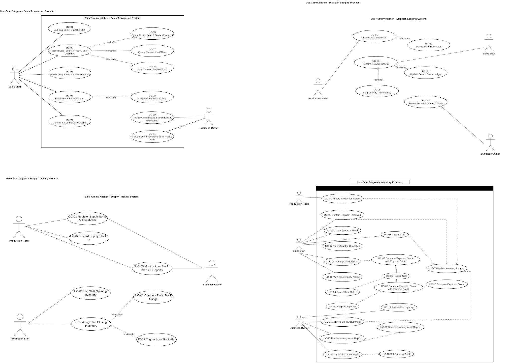
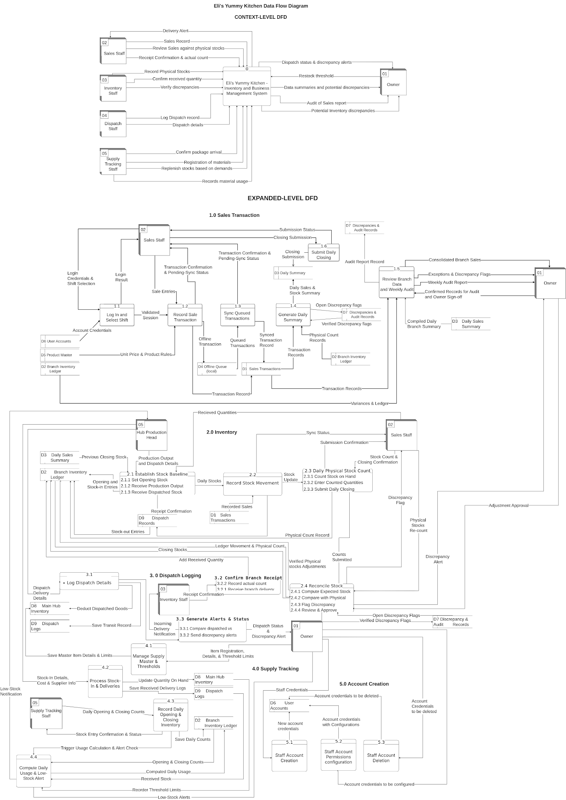
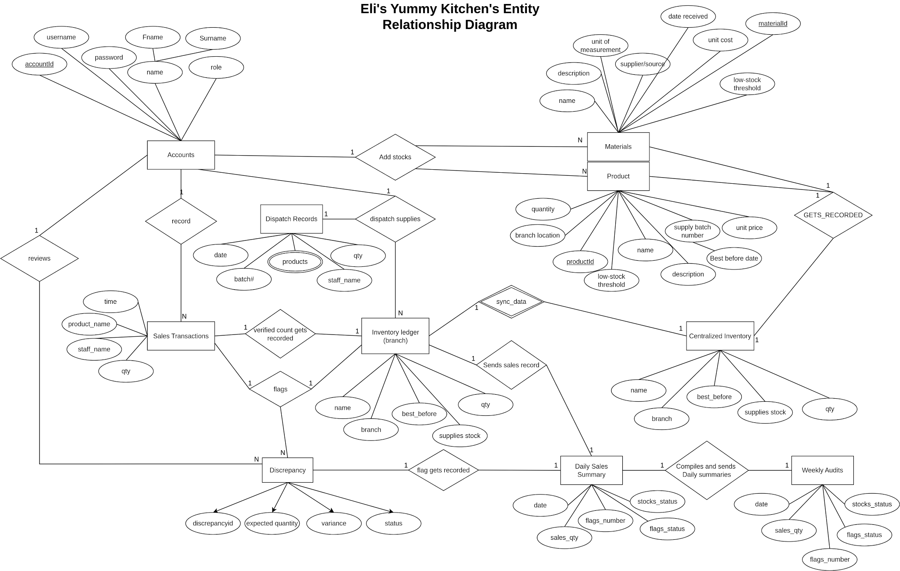

# System Diagrams (Phase 3 design)

The system follows these three diagrams. Image files are in `diagrams/`; the editable source is `diagrams/phase3-diagrams.drawio` (open at app.diagrams.net).

## 1. Use Case Diagrams

### Sales Transaction (11 use cases)
| ID | Use case | Actor | Relationship |
|---|---|---|---|
| UC-01 | Log In & Select Branch / Shift | Sales Staff | |
| UC-02 | Record Sale (Select Product, Enter Quantity) | Sales Staff | |
| UC-03 | Review Daily Sales & Stock Summary | Sales Staff | |
| UC-04 | Enter Physical Stock Count | Sales Staff | |
| UC-05 | Confirm & Submit Daily Closing | Sales Staff | |
| UC-06 | Compute Line Total & Stock Movement | | included by UC-02 |
| UC-07 | Queue Transaction Offline | | extends UC-02 |
| UC-08 | Sync Queued Transactions | | extends UC-02 |
| UC-09 | Flag Possible Discrepancy | | extends UC-04 |
| UC-10 | Review Consolidated Branch Data & Exceptions | Business Owner | |
| UC-11 | Include Confirmed Records in Weekly Audit | Business Owner | |

### Dispatch Logging (6 use cases)
| ID | Use case | Actor | Relationship |
|---|---|---|---|
| UC-01 | Create Dispatch Record | Production Head | |
| UC-02 | Deduct Main Hub Stock | | included by UC-01 |
| UC-03 | Confirm Delivery Receipt | Sales Staff | |
| UC-04 | Update Branch Stock Ledger | | included by UC-03 |
| UC-05 | Flag Delivery Discrepancy | | extends UC-03 |
| UC-06 | Review Dispatch Status & Alerts | Business Owner | |

### Supply Tracking (7 use cases)
| ID | Use case | Actor | Relationship |
|---|---|---|---|
| UC-01 | Register Supply Items & Thresholds | Production Head, Business Owner | |
| UC-02 | Record Supply Stock-In | Production Head | |
| UC-03 | Log Shift Opening Inventory | Production Staff | |
| UC-04 | Log Shift Closing Inventory | Production Staff | |
| UC-05 | Monitor Low-Stock Alerts & Reports | Production Head, Business Owner | |
| UC-06 | Compute Daily Stock Usage | | included by UC-04 |
| UC-07 | Trigger Low-Stock Alert | | extends UC-04 |

### Inventory Process, To-Be (18 use cases)
| ID | Use case | Actor |
|---|---|---|
| UC-01 | Record Production Output | Production Head |
| UC-02 | Confirm Dispatch Received | Sales Staff |
| UC-03 | Record Sale | Sales Staff |
| UC-04 | Sync Offline Sales | Sales Staff |
| UC-05 | Update Inventory Ledger | shared (included by production, dispatch, sale, adjustment) |
| UC-06 | Count Stock on Hand | Sales Staff |
| UC-07 | Enter Counted Quantities | Sales Staff |
| UC-08 | Submit Daily Closing | Sales Staff |
| UC-09 | Compare Expected Stock with Physical Count | shared (included by closing) |
| UC-10 | Compute Expected Stock | shared (included by UC-09) |
| UC-11 | Flag Discrepancy | shared |
| UC-12 | View Discrepancy Notice | Sales Staff |
| UC-13 | Review Discrepancy | Business Owner |
| UC-14 | Approve Stock Adjustment | Business Owner |
| UC-15 | Review Weekly Audit Report | Business Owner |
| UC-16 | Generate Weekly Audit Report | shared |
| UC-17 | Sign Off & Close Week | Business Owner |
| UC-18 | Set Opening Stock | shared |

## 2. Data Flow Diagram

**Context level:** the whole system is one process (0) with five external entities: Owner (01), Sales Staff (02), Inventory Staff (03), Dispatch Staff (04), Supply Tracking Staff (05). Staff send in sales records, stock counts, dispatch logs, material registrations and usage. The Owner sets restock thresholds and receives audit reports, discrepancy lists and dispatch alerts.

**Expanded level:**

| Process | Sub-processes | Main actors |
|---|---|---|
| 1.0 Sales Transaction | 1.1 Log in and select shift; 1.2 Record sale; 1.3 Sync queued transactions (offline); 1.4 Generate daily summary; 1.5 Owner review and weekly audit; 1.6 Submit daily closing | Sales Staff, Owner |
| 2.0 Inventory | 2.1 Establish stock baseline; 2.2 Record stock movement; 2.3 Daily physical count; 2.4 Reconcile stock (compute expected, compare, flag discrepancy, approve adjustment) | Hub Production Head, Sales Staff, Owner |
| 3.0 Dispatch Logging | 3.1 Log dispatch details; 3.2 Confirm branch receipt; 3.3 Compare dispatched vs received and send alerts | Hub Production Head, Inventory Staff, Owner |
| 4.0 Supply Tracking | 4.1 Manage supply master and thresholds; 4.2 Process stock-in; 4.3 Record daily opening and closing; 4.4 Compute usage and low-stock alert | Supply Tracking Staff, Owner |
| 5.0 Account Creation | 5.1 Create staff accounts; 5.2 Configure permissions; 5.3 Delete accounts | Owner |

**Data stores:** D1 Sales Transactions, D2 Branch Inventory Ledger, D3 Daily Summary, D4 Offline Queue (local device), D5 Product Master, D6 User Accounts, D7 Discrepancy & Audit Records, D8 Main Hub Inventory, D9 Dispatch Logs.

**Key flows**
- Sale → D1 → daily summary (D3) → Owner review.
- Dispatch → D9 and D8 → branch receipt → D2.
- Physical count versus ledger → discrepancy flag (D7) → Owner approval → adjustment of D2.

## 3. Entity Relationship Diagram

| Relationship | Between | Cardinality |
|---|---|---|
| Add stocks | Accounts, Materials / Product | 1 : N |
| record | Accounts, Sales Transactions | 1 : N |
| dispatch supplies | Accounts, Dispatch Records / Inventory Ledger | 1 : N |
| reviews | Accounts, Discrepancy | 1 : N |
| verified count gets recorded | Sales Transactions, Inventory Ledger | 1 : 1 |
| flags | Sales Transactions, Discrepancy (via Inventory Ledger) | 1 : N |
| sync_data | Inventory Ledger (branch), Centralized Inventory | 1 : 1 |
| GETS_RECORDED | Materials / Product, Centralized Inventory | 1 : 1 |
| Sends sales record | Inventory Ledger, Daily Sales Summary | 1 : 1 |
| flag gets recorded | Discrepancy, Daily Sales Summary | 1 : 1 |
| Compiles and sends Daily summaries | Daily Sales Summary, Weekly Audits | 1 : 1 |

See [DATA_DICTIONARY.md](DATA_DICTIONARY.md) for every attribute.
